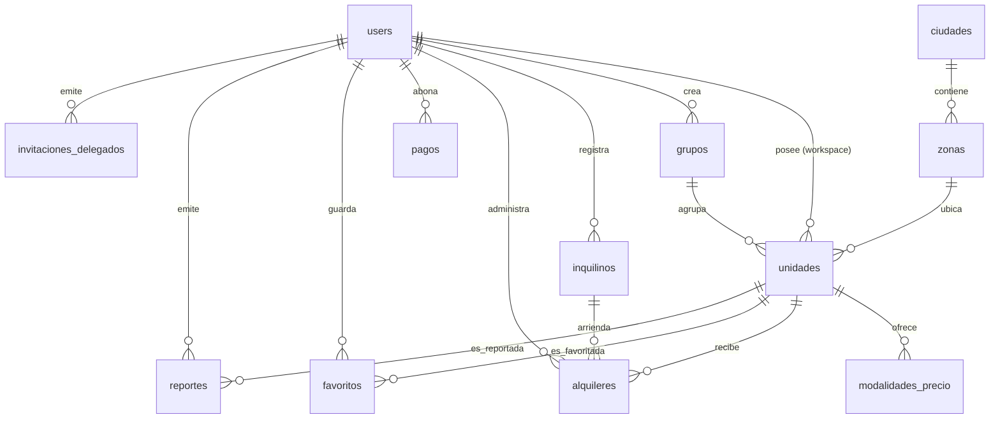

# Rendo — Marketplace Inmobiliario
### Documentación Técnica y de Producto Oficial (PRD + TRD + Architecture + Current State)

---

# SECCIÓN 1 – PRD (Product Requirements Document)

## 1.1 Visión del Producto

**Rendo** es una plataforma SaaS y marketplace inmobiliario integral diseñada para resolver la fricción entre la búsqueda de disponibilidad y la formalización de alquileres en Goya, Corrientes, Argentina (con capacidad de expansión regional e internacional).

El producto empodera a los **Gestores** (dueños directos o administradores/inmobiliarias) con control absoluto y manual sobre sus **Unidades**, ofreciendo tanto una vidriera pública multi-idioma de alto impacto estético y rendimiento (Next.js SSR/SSG con geolocalización abierta y contacto directo sin intermediarios bloqueantes), como un potente panel operativo web-only (Terminal Financiero/Gestión) para la administración de Unidades, Grupos, Inquilinos, Alquileres, Señas, Delegados y Facturación de Cupos.

> **Invariante Central del Modelo de Negocio:** La plataforma **NUNCA procesa ni retiene el dinero del alquiler** entre el Gestor y el inquilino buscador. La monetización de la plataforma se basa exclusivamente en el cobro de una suscripción mensual al Gestor por **Cupo** de Unidades administradas (1:1 por Unidad activa, esté o no publicada en el marketplace).

---

## 1.2 Glosario de Dominio y Terminología Canónica

El sistema impone un vocabulario estricto e inmutable a nivel de base de datos, código y diseño:

| Término Canónico | Definición | Alias Prohibidos (*Avoid*) |
|---|---|---|
| **Unidad** | Entidad individual y alquilable (departamento, cabaña, casa, local comercial, salón de eventos, cancha). Es la unidad atómica de facturación de la plataforma (1:1). | Propiedad, Inmueble |
| **Grupo** | Contenedor organizativo opcional con nombre libre (ej. "Edificio Costanera", "Complejo Cabañas") para estructurar las Unidades del Gestor. No factura ni afecta precios. | Edificio, Bloque, Complejo |
| **Gestor** | Usuario administrador de una o más Unidades. Puede ser el propietario o una inmobiliaria/tercero. Todo usuario se convierte en Gestor al dar de alta su primera Unidad. | Administrador, Dueño, Propietario |
| **Delegado** | Colaborador con cuenta propia y verificada, invitado por email a un workspace de Gestor, con permisos granulares (Ver / Gestionar). Nunca accede a Facturación ni al Log maestro. | Empleado, Colaborador, Operador |
| **Inquilino** | Registro propio y libre en la cartera del Gestor (nombre, documento, teléfono, email) para asociar a los Alquileres. No requiere tener cuenta en la plataforma. | Cliente, Arrendatario, Huésped |
| **Cupo** | Cantidad máxima de Unidades que un Gestor puede mantener simultáneamente en estado Activo (no archivadas). Se adquiere y renueva mediante suscripción/packs. | Plan, Límite, Paquete |
| **Alquiler** | Registro histórico de un arrendamiento formal: rango de fechas (`fecha_inicio` a `fecha_fin`), monto total, Inquilino asignado, contrato PDF opcional y pagos asociados. | Contrato, Reserva |
| **Modalidad de Precio** | Combinación de unidad de tiempo (`día`, `hora`, etc.), cantidad de tiempo y precio en ARS (ej. 1 día = Diario, 7 días = Semanal, 30 días = Mensual). | Tarifa, Plan de alquiler |
| **Seña** | Pago inicial registrado que bloquea automáticamente las fechas correspondientes en el calendario público de disponibilidad. | Anticipo, Seña de reserva |
| **Zona** | Subdivisión geográfica de una Ciudad (ej. Centro, Norte, Sur en Goya), administrada como catálogo fijo. | Barrio, Localidad |

---

## 1.3 Actores del Sistema

| Rol / Actor | Descripción |
|---|---|
| **Usuario Buscador (Inquilino Potencial)** | Usuario que navega el marketplace. Puede consultar publicaciones y mapas aproximados sin autenticarse. Para ver la ubicación exacta, chatear o contactar por WhatsApp y guardar Favoritos, debe registrarse obligatoriamente. |
| **Gestor (Owner de Workspace)** | Dueño de la cuenta operativa. Administra Unidades, Grupos, Inquilinos, Alquileres, modalidades de cobro, invita Delegados y contrata/renueva su Cupo de facturación. |
| **Delegado** | Usuario con membresía en el workspace de un Gestor (`workspace_id`). Puede ver o gestionar las Unidades, Grupos e Inquilinos asignados, pero tiene restringido el acceso a Facturación. |
| **Administrador de Plataforma (Dev Dashboard)** | Equipo central que gestiona la cola de moderación, resuelve reportes de Unidades, aprueba pagos manuales (efectivo/transferencia) y audita la plataforma. |

---

## 1.4 Alcance del Producto (Módulos Funcionales)

| ID | Módulo | Plataforma / Canal | Estado Actual |
|---|---|---|---|
| **M1** | **Marketplace Público & Wizard de Búsqueda** | Web Responsive (Next.js SSR/SSG + i18n) | **Construido y Operativo** |
| **M2** | **Ficha de Detalle de Unidad con OpenStreetMap** | Web Responsive (Leaflet + OSM) | **Construido y Operativo** |
| **M3** | **Autenticación Híbrida (Teléfono OTP + Email/Password)** | Web (Supabase Auth SSR) | **Construido y Operativo** |
| **M4** | **Panel del Gestor & Métricas de Dashboard** | Web Desktop / Mobile (Next.js App Router) | **Construido y Operativo** |
| **M5** | **Gestión de Inventario (CRUD Unidades & Modalidades)** | Web (Next.js + NestJS API + Storage) | **Construido y Operativo** |
| **M6** | **Gestión de Grupos Organizativos** | Web (Next.js + NestJS API) | **Construido y Operativo** |
| **M7** | **CRM de Inquilinos** | Web (Next.js + NestJS API) | **Construido y Operativo** |
| **M8** | **Historial y Control de Alquileres** | Web (Next.js + NestJS API) | **Construido y Operativo** |
| **M9** | **Sistema de Cupo y Facturación (Mercado Pago + Efectivo)** | Web (NestJS API + SDK Mercado Pago) | **Construido y Operativo** |
| **M10** | **RBAC & Gestión de Delegados** | Web & Backend (Supabase RLS Workspace) | **Construido y Operativo** |
| **M11** | **Favoritos y Reportes de Usuarios** | Web & Backend API | **Construido y Operativo** |
| **M12** | **Servicio de Auto-traducción (i18n)** | Backend Service (es / en / pt) | **Construido (Mock/Adapter)** |
| **M13** | **Facturación AFIP (afip-apis)** | Backend Service | **Planificado (Fase 4)** |
| **M14** | **Capacitor Mobile Wrapper (Android APK / Play Store)** | Mobile App WebView | **Planificado (Fase 5)** |

---

## 1.5 Requerimientos Funcionales

### RF-Marketplace y Público (Inquilino / Buscador)
- **RF-M01:** Búsqueda libre sin login mediante SearchWizard de 3 pasos (Categoría, Zona, Precio Máximo).
- **RF-M02:** Filtrado avanzado por texto indexado (`to_tsvector` en español), rango de precios, zonas y capacidad.
- **RF-M03:** Ficha pública con galería fotográfica (hasta 10 fotos), especificaciones, modalidades de precio disponibles y descripción multi-idioma (es, pt, en).
- **RF-M04:** Visualización de mapa aproximado sin autenticación; revelación del pin de coordenadas exactas y georreferenciación únicamente a usuarios autenticados.
- **RF-M05:** Contacto directo vía enlace enriquecido de WhatsApp (`wa.me`) con texto preformateado conteniendo el título y referencia de la Unidad.
- **RF-M06:** Sistema de Favoritos con persistencia por usuario autenticado.
- **RF-M07:** Sistema de Reportes de publicaciones con motivo explícito, restringido a usuarios logueados (un reporte por usuario/unidad).

### RF-Panel del Gestor (Backoffice Operativo)
- **RF-G01:** Dashboard analítico con estado de Cupo usado vs. disponible, barra de progreso porcentual, conteo de alquileres activos y alertas preventivas de vencimiento de suscripción (amarillo a 7 días, rojo ante vencimiento).
- **RF-G02:** CRUD integral de Unidades con selector de categoría abierta (departamento, cabaña, salón, cancha, casa, local comercial) y atributos dinámicos en JSONB.
- **RF-G03:** Subida y supresión de imágenes hacia Supabase Storage (hasta 10 fotos por Unidad) con generación de URLs públicas.
- **RF-G04:** Selector geográfico interactivo (`LocationPickerMap`) para fijar la ubicación exacta y generación automática de la coordenada aproximada redondeada a 3 decimales.
- **RF-G05:** Configuración de múltiples modalidades de precio por Unidad (unidad de tiempo: hora/día, cantidad y precio).
- **RF-G06:** Máquina de estados finita para la Unidad: transición manual controlada por el Gestor (`borrador`, `publicada`, `pausada`, `no_disponible`, `archivada`).
- **RF-G07:** Cooldown estricto de 15 días para desarchivar una Unidad previamente archivada, impidiendo la rotación fraudulenta del Cupo.
- **RF-G08:** Agrupamiento de Unidades en Grupos arbitrarios para organización de inventario.
- **RF-G09:** Cartera de Inquilinos (CRM privado) con nombre, email, teléfono y documento de identidad.
- **RF-G10:** Registro de Alquileres asociando Unidad e Inquilino, con rango de fechas (`fecha_inicio`, `fecha_fin`), monto total y estados (`activo`, `finalizado`, `cancelado`).
- **RF-G11:** Módulo de Facturación y Packs de Cupo: adquisición de cupo mediante Checkout Pro de Mercado Pago (preferencias webhook/IPN) y registro de pagos manuales por transferencia/efectivo.
- **RF-G12:** Invitación y gestión de Delegados por correo electrónico con restricción estricta de visualización (los delegados no tienen acceso a Facturación).

### RF-Reglas de Negocio Automatizadas e Invariantes
- **RF-A01 (Excepción 1):** Bloqueo automático en el calendario público al registrarse una Seña en un Alquiler.
- **RF-A02 (Excepción 2):** Bloqueo automático por impago (`bloqueada_por_impago`) al expirar la suscripción del Gestor sin renovación.
- **RF-A03 (Excepción 3):** Paso automático de la Unidad a estado `en_revision` al alcanzar el umbral de 50 reportes de usuarios registrados.
- **RF-A04 (Excepción 4):** Auto-archivado ordenado por fecha de creación (excluyendo Unidades con Alquiler activo) ante degradación o expiración de Cupo.
- **RF-A05:** Borrado lógico universal (`deleted_at IS NOT NULL`) en todas las tablas transaccionales. Nunca se ejecuta un `DELETE` físico en producción.

---

## 1.6 Requerimientos No Funcionales

- **RNF-01 (Strict TypeScript):** Todo el monorepo opera con TypeScript en modo estricto (`strict: true`, `noImplicitAny: true`). Prohibido el uso de `any`.
- **RNF-02 (Seguridad RLS):** Row Level Security (RLS) habilitado en PostgreSQL como primera línea de defensa para aislamiento de workspaces mediante la función `get_workspace_id()`.
- **RNF-03 (Performance SSR/SSG):** Rutas públicas del marketplace optimizadas para Core Web Vitals y rastreo de motores de búsqueda (SEO local para Goya y Corrientes).
- **RNF-04 (Diseño UI/UX Impeccable):** Interfaz basada en Tailwind CSS + componentes shadcn/ui con estética "Terminal Financiero" en el panel operativo y "Glassmorphism / Organic Blobs" en el marketplace público.
- **RNF-05 (Soporte Multi-idioma):** Enrutamiento internacionalizado nativo (`/es/`, `/en/`, `/pt/`) gestionado por `next-intl` con traducciones en archivos JSON independientes.
- **RNF-06 (Auditoría & Testabilidad):** Suite de pruebas E2E automatizadas con Playwright cubriendo flujos de Gestor, monetización, creación de unidades, búsqueda y navegación mobile.

---

# SECCIÓN 2 – TRD (Technical Requirements Document)

## 2.1 Stack Tecnológico

### Frontend Web (`apps/web`)
| Componente | Tecnología | Versión / Detalle |
|---|---|---|
| **Framework Base** | Next.js | 14.2.x (App Router) |
| **Lenguaje** | TypeScript | 5.5.x (`strict: true`) |
| **Estilos** | Tailwind CSS | 3.4.x con plugin `tailwindcss-animate` |
| **Componentes UI** | shadcn/ui | Radix UI primitives |
| **Internacionalización** | next-intl | 3.19.x (Middleware + Server Components) |
| **Mapas & Geocoding** | Leaflet + React-Leaflet | OpenStreetMap tiles (sin costo de API) |
| **Formularios & Validación**| React Hook Form + Zod | 7.53.x / 3.23.x |
| **Cliente Supabase** | `@supabase/ssr` | Manejo seguro de cookies en Server/Client components |
| **Íconos** | Lucide React | 0.441.x |

### Backend API (`apps/api`)
| Componente | Tecnología | Versión / Detalle |
|---|---|---|
| **Framework Base** | NestJS | 11.0.x (Express bajo el capó) |
| **Lenguaje** | TypeScript | 5.7.x (`strict: true`) |
| **Autenticación** | `@nestjs/jwt` + Supabase Guard | Verificación de JWT Bearer y resolución de Workspace |
| **Validación DTO** | `class-validator` + `class-transformer` | Validación estricta en tiempo de ejecución |
| **Pasarela de Pagos** | `mercadopago` SDK | 2.3.x (Checkout Pro & Webhooks) |
| **Cliente Supabase** | `@supabase/supabase-js` | Conexión con Anon Key y Service Role |
| **Variables de Entorno** | `@nestjs/config` | ConfigModule global |

### Infraestructura & Persistencia
| Componente | Proveedor / Servicio | Configuración |
|---|---|---|
| **Base de Datos** | Supabase Postgres 15 | Extensiones `pgcrypto`, Triggers PL/pgSQL, RLS |
| **Autenticación** | Supabase Auth | OTP SMS / Email Password / Google OAuth |
| **Storage de Medios** | Supabase Storage | Bucket público `unidades` (fotos hasta 10MB) |
| **Monorepo Manager** | Turborepo + pnpm workspaces | Orquestación de scripts `dev`, `build`, `lint` |
| **Testing E2E** | Playwright Test | Ejecución en navegadores Chromium Desktop y Mobile |

---

## 2.2 Arquitectura del Sistema

```text
┌────────────────────────────────────────────────────────────────────────┐
│                          NAVEGADOR / CLIENTE                           │
│   ┌──────────────────────────────────┐ ┌───────────────────────────┐   │
│   │   Marketplace Público (SSR/SSG) │ │  Panel del Gestor (Web)   │   │
│   │   - Glassmorphism & SearchWizard │ │  - Terminal Financiero    │   │
│   │   - Leaflet Maps (OSM)           │ │  - CRM, Unidades, Cupos   │   │
│   └─────────────────┬────────────────┘ └─────────────┬─────────────┘   │
└─────────────────────┼────────────────────────────────┼─────────────────┘
                      │                                │
                      ▼                                ▼
┌────────────────────────────────────────────────────────────────────────┐
│                     NEXT.JS WEB APP (apps/web)                         │
│  - Middleware: next-intl (locale routing: /es, /pt, /en)               │
│  - Supabase SSR Cookie Exchange                                        │
│  - Server Components (Fetch directo con token Bearer)                  │
└─────────────────────┬────────────────────────────────┬─────────────────┘
                      │                                │
                      │ HTTP / REST                    │ Auth Token
                      ▼                                ▼
┌────────────────────────────────────────────────────────────────────────┐
│                     NESTJS BACKEND API (apps/api)                      │
│  ┌──────────────────────────────────────────────────────────────────┐  │
│  │ SupabaseAuthGuard: Valida Token -> Inyecta user & workspace_id    │  │
│  └──────────────────────────────────┬───────────────────────────────┘  │
│                                     │                                  │
│  ┌──────────────────────────────────┴───────────────────────────────┐  │
│  │ Controladores y Servicios Modulares:                             │  │
│  │ [Unidades] [Marketplace] [Cupo] [Pagos] [Inquilinos] [Alquileres]│  │
│  │ [Grupos]   [Delegados]   [Favoritos]    [Reportes]   [Traducción]│  │
│  └──────────────────────────────────┬───────────────────────────────┘  │
└─────────────────────────────────────┼──────────────────────────────────┘
                                      │
              ┌───────────────────────┴────────────────────────┐
              ▼                                                ▼
┌──────────────────────────────────────┐     ┌───────────────────────────┐
│     SUPABASE (PostgreSQL + RLS)      │     │  MERCADO PAGO (Checkout)  │
│  - Tablas transaccionales            │     │  - Preferencias de pago   │
│  - Row Level Security (Workspaces)   │     │  - Webhook de aprobación  │
│  - Supabase Auth & Storage (Fotos)   │     └───────────────────────────┘
└──────────────────────────────────────┘
```

---

## 2.3 Estructura del Monorepo

```text
TFI/
├── apps/
│   ├── api/                           # Backend NestJS
│   │   ├── src/
│   │   │   ├── alquileres/            # Módulo de Alquileres (Contratos)
│   │   │   ├── auth/                  # SupabaseAuthGuard & AuthenticatedRequest
│   │   │   ├── common/                # Servicios transversales (Traducción)
│   │   │   ├── cupo/                  # Validación de límites de Unidades
│   │   │   ├── delegados/             # RBAC de colaboradores del Gestor
│   │   │   ├── favoritos/             # Guardado de Unidades favoritas
│   │   │   ├── grupos/                # Agrupamiento organizativo de Unidades
│   │   │   ├── inquilinos/            # CRM de clientes del Gestor
│   │   │   ├── marketplace/           # Consultas públicas, filtros y mapas
│   │   │   ├── pagos/                 # Pasarela Mercado Pago & Efectivo
│   │   │   ├── reportes/              # Denuncias de usuarios a Unidades
│   │   │   ├── supabase/              # Inyección del cliente Supabase
│   │   │   ├── unidades/              # CRUD Unidades, Modalidades y Cooldown
│   │   │   ├── app.module.ts          # Módulo raíz de NestJS
│   │   │   └── main.ts                # Bootstrap de API en puerto 3001
│   │   ├── package.json
│   │   └── tsconfig.json
│   │
│   └── web/                           # Frontend Next.js 14
│       ├── e2e/                       # Suite de tests con Playwright
│       │   ├── auth.setup.ts
│       │   ├── gestor.spec.ts
│       │   ├── marketplace.spec.ts
│       │   └── ux_audit.spec.ts
│       ├── messages/                  # Diccionarios i18n (es.json, en.json, pt.json)
│       ├── public/brand/              # Isotipos y logotipos oficiales de Rendo
│       ├── src/
│       │   ├── app/
│       │   │   ├── [locale]/
│       │   │   │   ├── (gestor)/      # Panel protegido del Gestor
│       │   │   │   │   ├── alquileres/
│       │   │   │   │   ├── dashboard/
│       │   │   │   │   ├── delegados/
│       │   │   │   │   ├── facturacion/
│       │   │   │   │   ├── grupos/
│       │   │   │   │   ├── inquilinos/
│       │   │   │   │   ├── mis-unidades/
│       │   │   │   │   └── layout.tsx
│       │   │   │   ├── (marketplace)/ # Vistas públicas
│       │   │   │   │   ├── unidades/[id]/
│       │   │   │   │   ├── layout.tsx
│       │   │   │   │   └── page.tsx
│       │   │   │   ├── auth/          # Login y Registro
│       │   │   │   │   ├── login/
│       │   │   │   │   └── registro/
│       │   │   │   └── layout.tsx
│       │   │   └── globals.css
│       │   ├── components/
│       │   │   ├── gestor/            # Formularios, Sidebar, MapPicker, Facturación
│       │   │   ├── marketplace/       # Cards, SearchWizard, Map, WhatsApp, Favorito
│       │   │   └── ui/                # Componentes shadcn (Buttons, Dialogs, Tables)
│       │   ├── i18n/                  # Configuración de rutas y locales
│       │   ├── lib/                   # Supabase client, server y middleware helpers
│       │   └── middleware.ts          # Chain de intlMiddleware + authSession
│       ├── package.json
│       └── tailwind.config.ts
│
├── packages/
│   ├── database/                      # Tipos de DB compartidos
│   ├── types/                         # Interfaces de dominio y pricing config
│   └── ui/                            # Configuración compartida de diseño
│
├── supabase/
│   ├── migrations/                    # 12 Migraciones SQL versionadas
│   └── config.toml
│
├── pnpm-workspace.yaml
├── turbo.json
└── package.json
```

---

## 2.4 Catálogo de Endpoints REST de la API

Todos los endpoints que requieren autenticación consumen el token JWT emitido por Supabase en el encabezado `Authorization: Bearer <token>`.

### Módulo Unidades (`/unidades`)
| Método | Endpoint | Descripción | Acceso |
|---|---|---|---|
| `POST` | `/unidades` | Crea una nueva Unidad en estado `borrador`. Valida Cupo disponible. | Gestor / Delegado |
| `GET` | `/unidades` | Lista paginada de Unidades del workspace con filtros. | Gestor / Delegado |
| `GET` | `/unidades/:id` | Detalle de la Unidad con sus modalidades de precio. | Gestor / Delegado |
| `PATCH` | `/unidades/:id` | Actualiza atributos, textos o fotos de la Unidad. | Gestor / Delegado |
| `PATCH` | `/unidades/:id/estado` | Modifica el estado operativo validando máquina de estados y cooldown. | Gestor / Delegado |
| `DELETE` | `/unidades/:id` | Ejecuta borrado lógico (`deleted_at = NOW()`). | Gestor / Delegado |
| `POST` | `/unidades/:id/modalidades` | Añade una modalidad de precio (día/hora). | Gestor / Delegado |
| `PATCH` | `/unidades/:id/modalidades/:modId` | Actualiza valores de una modalidad. | Gestor / Delegado |
| `DELETE` | `/unidades/:id/modalidades/:modId` | Borrado lógico de una modalidad de precio. | Gestor / Delegado |
| `GET` | `/unidades/:id/alquileres` | Historial de alquileres asociados a la Unidad. | Gestor / Delegado |

### Módulo Marketplace (`/marketplace`)
| Método | Endpoint | Descripción | Acceso |
|---|---|---|---|
| `GET` | `/marketplace/unidades` | Búsqueda pública paginada con filtros (`q`, `zona_id`, `categoria`, precios). | Público |
| `GET` | `/marketplace/unidades/:id` | Ficha pública. Devuelve ubicación exacta solo si hay token válido. | Público / Autenticado |
| `GET` | `/marketplace/zonas` | Catálogo jerárquico de Ciudades y Zonas disponibles. | Público |

### Módulo Cupo & Facturación (`/cupo` & `/pagos`)
| Método | Endpoint | Descripción | Acceso |
|---|---|---|---|
| `GET` | `/cupo` | Retorna cupo máximo, usado, disponible y fecha de expiración. | Gestor / Delegado |
| `POST` | `/pagos/mercadopago/preferencia` | Crea preferencia de pago en Mercado Pago para adquirir Cupo. | Gestor |
| `POST` | `/pagos/mercadopago/webhook` | Recibe notificación asíncrona de MP e incrementa el cupo del usuario. | Público (Webhook MP) |
| `POST` | `/pagos/efectivo` | Registra solicitud de pago en efectivo/transferencia manual. | Gestor |

### Módulo Inquilinos (`/inquilinos`)
| Método | Endpoint | Descripción | Acceso |
|---|---|---|---|
| `POST` | `/inquilinos` | Registra un nuevo Inquilino en la cartera del Gestor. | Gestor / Delegado |
| `GET` | `/inquilinos` | Lista de Inquilinos del workspace con paginación. | Gestor / Delegado |
| `PATCH` | `/inquilinos/:id` | Edita datos de contacto o documento del Inquilino. | Gestor / Delegado |
| `DELETE` | `/inquilinos/:id` | Borrado lógico del Inquilino. | Gestor / Delegado |

### Módulo Alquileres (`/alquileres`)
| Método | Endpoint | Descripción | Acceso |
|---|---|---|---|
| `POST` | `/alquileres` | Crea un Alquiler vinculando Unidad, Inquilino, fechas y monto. | Gestor / Delegado |
| `GET` | `/alquileres` | Lista de Alquileres del workspace. | Gestor / Delegado |
| `PATCH` | `/alquileres/:id` | Modifica fechas, monto o estado (`activo`, `finalizado`, `cancelado`). | Gestor / Delegado |
| `DELETE` | `/alquileres/:id` | Borrado lógico del Alquiler. | Gestor / Delegado |

### Módulo Grupos, Delegados, Favoritos & Reportes
| Método | Endpoint | Descripción | Acceso |
|---|---|---|---|
| `GET` | `/grupos` | Lista de Grupos organizativos del workspace. | Gestor / Delegado |
| `POST` | `/grupos` | Crea un nuevo Grupo. | Gestor / Delegado |
| `GET` | `/delegados` | Lista de delegados activos e invitaciones pendientes. | Gestor (Owner) |
| `POST` | `/delegados/invitar` | Emite invitación a un Delegado por email. | Gestor (Owner) |
| `GET` | `/favoritos` | Lista de Unidades marcadas como favoritas por el usuario. | Autenticado |
| `POST` | `/favoritos` | Añade una Unidad a favoritos. | Autenticado |
| `DELETE` | `/favoritos/:unidad_id` | Remueve una Unidad de favoritos. | Autenticado |
| `POST` | `/reportes` | Denuncia una publicación (auto-suspende si alcanza 50). | Autenticado |

---

## 2.5 Aislamiento Multi-Tenant (Workspaces) y RLS

A diferencia de sistemas que filtran únicamente por `user_id` simple, Rendo implementa un modelo de **Workspaces Corporativos** respaldado por Row Level Security (RLS) en Postgres:

1. **Jerarquía Gestor-Delegado:**
   - La tabla `users` contiene las columnas `rol` (`'gestor'` | `'delegado'`) y `workspace_id` (UUID referenciando al Gestor dueño).
   - Para un Gestor dueño, su `workspace_id` es su propio `id`.
   - Para un Delegado, su `workspace_id` apunta al `id` del Gestor que lo invitó.
2. **Función de Seguridad RLS en Base de Datos:**
   ```sql
   CREATE OR REPLACE FUNCTION get_workspace_id() RETURNS UUID AS $$
     SELECT COALESCE(workspace_id, id) FROM public.users WHERE id = auth.uid();
   $$ LANGUAGE sql SECURITY DEFINER STABLE;
   ```
3. **Políticas RLS en Tablas de Negocio:**
   Las tablas `unidades`, `grupos`, `inquilinos`, `alquileres` y `pagos` validan que:
   ```sql
   USING (gestor_id = get_workspace_id())
   WITH CHECK (gestor_id = get_workspace_id());
   ```
4. **Validación en NestJS (`SupabaseAuthGuard`):**
   El guard intercepta el token JWT, recupera el usuario desde Supabase Auth, consulta en `public.users` su rol y `workspace_id`, e inyecta en el objeto `Request` la entidad autenticada:
   ```typescript
   request.user = {
     ...data.user,
     rol: userData?.rol || 'gestor',
     workspace_id: userData?.workspace_id || data.user.id,
   };
   ```

---

# SECCIÓN 3 – Diseño UI/UX

## 3.1 Principios de Diseño

- **Doble Personalidad Visual Coherente:**
  1. **Marketplace Público:** Experiencia orientada al consumidor final con estética luminosa, *Glassmorphism*, gradientes orgánicos (`blur-[120px]`), tipografía moderna y microinteracciones de entrada (`fade-in`, `zoom-in`).
  2. **Panel Operativo del Gestor:** Diseñado bajo el concepto de **"Terminal Financiero"**. Fondo limpio, tablas de alta densidad, bordes técnicos, badges de estado en tipografía monospace (`font-mono text-[10px] uppercase`), y navegación rápida mediante *ScrollSpy* lateral.
- **Transparencia & Sin Intermediarios:** Los canales de contacto (WhatsApp con mensaje pre-llenado) son directos y prominentes, eliminando barreras de comunicación.
- **Mobile-First Estricto:** La navegación se adapta desde pantallas móviles de 375px mediante menús tipo Sheet hamburguesa, navegación sticky inferior y modales accesibles.

## 3.2 Sistema de Diseño & Tokens Base (Rendo Canónico)

Sistema cromático derivado de los colores de marca oficiales (Azul ~224° y Dorado ~38°, complementarios a ~186°):

### Colores de Marca (Base)
| Nombre | Hex | Uso |
|---|---|---|
| **Crema** | `#FDF6E4` | Fondo principal — modo claro |
| **Dorado** | `#B7904D` | Color primario / acento de marca |
| **Azul (Navy)** | `#101A35` | Texto principal / fondo — modo oscuro |

### Escala Azul (Navy)
| Token | Hex | Uso sugerido |
|---|---|---|
| `azul-50` | `#EFF2FA` | Fondo de sección sutil (modo claro) |
| `azul-100` | `#D8DFF3` | Bordes suaves sobre crema |
| `azul-200` | `#B0BFE8` | Elementos deshabilitados |
| `azul-300` | `#768FD6` | Iconos secundarios |
| `azul-400` | `#3B5FC4` | Links, acentos interactivos |
| `azul-500` | `#294389` | Hover de botón azul |
| `azul-600` | `#1D3062` | Active / pressed |
| `azul-700` | `#152247` | Superficie elevada (cards en dark mode) |
| `azul-800` | `#101B37` | Fondo principal — modo oscuro |
| `azul-900` | `#090F1F` | Fondo más profundo (modales, overlays) |

### Escala Dorado
| Token | Hex | Uso sugerido |
|---|---|---|
| `dorado-50` | `#F3EDE2` | Hover muy sutil sobre crema |
| `dorado-100` | `#E9DDC9` | Fondo de badge / chip |
| `dorado-200` | `#DAC6A4` | Bordes decorativos |
| `dorado-300` | `#C8AB79` | Iconos secundarios dorados |
| `dorado-500` | `#B7904E` | **Dorado base de marca** — CTA primario |
| `dorado-600` | `#98773E` | Hover / pressed del CTA primario |
| `dorado-700` | `#745B2F` | Texto dorado sobre fondo claro (AA) |
| `dorado-800` | `#503E21` | Texto dorado sobre fondo muy claro |

### Neutrales Cálidos
| Token | Hex | Uso sugerido |
|---|---|---|
| `neutro-50` | `#FBFAF9` | Fondo de card sobre crema |
| `neutro-100` | `#F4F3F1` | Fondo de sección alterna |
| `neutro-200` | `#E9E6E2` | Bordes, separadores |
| `neutro-300` | `#D2CEC6` | Bordes de inputs |
| `neutro-400` | `#B0A99B` | Placeholder / texto deshabilitado |
| `neutro-500` | `#8F8470` | Texto terciario |
| `neutro-600` | `#645C4F` | Texto secundario |
| `neutro-700` | `#3F3A31` | Texto secundario (dark mode) |
| `neutro-800` | `#28251F` | Texto principal (modo claro) |
| `neutro-900` | `#171512` | Texto principal (máximo contraste) |

### Colores Semánticos
| Estado | Tokens y Hex | Uso |
|---|---|---|
| **Éxito / Disponible** | `50: #E6F0EB`, `300: #80B299`, `500: #568F73` (verde salvia), `700: #39604D` | Disponibilidad, validaciones |
| **Error / No disponible** | `50: #F8DFDD`, `300: #E99B96`, `500: #D74C42`, `700: #A82D24` | Alertas, unidades no disponibles |
| **Advertencia** | `50: #FBEED0`, `300: #F5D589`, `500: #EFB839` (ámbar), `700: #D49A11` | Vencimientos, pagos pendientes |
| **Info** | `50: #DDEAF8`, `300: #96BCE9`, `500: #4E8FDA`, `700: #286EBD` | Notificaciones, tips |
| **Terracota** | `50: #F4DED7`, `300: #E2AD9C`, `500: #B25134`, `700: #7E3A25` | Promociones, destacados especiales |

### Tokens CSS (Variables)
```css
:root {
  /* Marca */
  --color-crema: #FDF6E4;
  --color-dorado: #B7904D;
  --color-azul: #101A35;

  /* Azul */
  --azul-50: #EFF2FA;
  --azul-100: #D8DFF3;
  --azul-200: #B0BFE8;
  --azul-300: #768FD6;
  --azul-400: #3B5FC4;
  --azul-500: #294389;
  --azul-600: #1D3062;
  --azul-700: #152247;
  --azul-800: #101B37;
  --azul-900: #090F1F;

  /* Dorado */
  --dorado-50: #F3EDE2;
  --dorado-100: #E9DDC9;
  --dorado-200: #DAC6A4;
  --dorado-300: #C8AB79;
  --dorado-500: #B7904E;
  --dorado-600: #98773E;
  --dorado-700: #745B2F;
  --dorado-800: #503E21;

  /* Neutrales */
  --neutro-50: #FBFAF9;
  --neutro-100: #F4F3F1;
  --neutro-200: #E9E6E2;
  --neutro-300: #D2CEC6;
  --neutro-400: #B0A99B;
  --neutro-500: #8F8470;
  --neutro-600: #645C4F;
  --neutro-700: #3F3A31;
  --neutro-800: #28251F;
  --neutro-900: #171512;

  /* Semánticos */
  --exito-50: #E6F0EB;
  --exito-300: #80B299;
  --exito-500: #568F73;
  --exito-700: #39604D;

  --error-50: #F8DFDD;
  --error-300: #E99B96;
  --error-500: #D74C42;
  --error-700: #A82D24;

  --warning-50: #FBEED0;
  --warning-300: #F5D589;
  --warning-500: #EFB839;
  --warning-700: #D49A11;

  --info-50: #DDEAF8;
  --info-300: #96BCE9;
  --info-500: #4E8FDA;
  --info-700: #286EBD;

  --terracota-50: #F4DED7;
  --terracota-300: #E2AD9C;
  --terracota-500: #B25134;
  --terracota-700: #7E3A25;
}

/* Modo oscuro: dorado sobre navy, monocromático */
[data-theme="dark"] {
  --bg-principal: var(--azul-800);
  --bg-elevado: var(--azul-700);
  --texto-principal: var(--dorado-100);
  --acento: var(--dorado-500);
}
```

### Configuración Tailwind CSS
```javascript
// tailwind.config.js
module.exports = {
  theme: {
    extend: {
      colors: {
        crema: '#FDF6E4',
        azul: {
          50: '#EFF2FA', 100: '#D8DFF3', 200: '#B0BFE8', 300: '#768FD6',
          400: '#3B5FC4', 500: '#294389', 600: '#1D3062', 700: '#152247',
          800: '#101B37', 900: '#090F1F',
        },
        dorado: {
          50: '#F3EDE2', 100: '#E9DDC9', 200: '#DAC6A4', 300: '#C8AB79',
          500: '#B7904E', 600: '#98773E', 700: '#745B2F', 800: '#503E21',
        },
        neutro: {
          50: '#FBFAF9', 100: '#F4F3F1', 200: '#E9E6E2', 300: '#D2CEC6',
          400: '#B0A99B', 500: '#8F8470', 600: '#645C4F', 700: '#3F3A31',
          800: '#28251F', 900: '#171512',
        },
        exito: { 50: '#E6F0EB', 300: '#80B299', 500: '#568F73', 700: '#39604D' },
        error: { 50: '#F8DFDD', 300: '#E99B96', 500: '#D74C42', 700: '#A82D24' },
        warning: { 50: '#FBEED0', 300: '#F5D589', 500: '#EFB839', 700: '#D49A11' },
        info: { 50: '#DDEAF8', 300: '#96BCE9', 500: '#4E8FDA', 700: '#286EBD' },
        terracota: { 50: '#F4DED7', 300: '#E2AD9C', 500: '#B25134', 700: '#7E3A25' },
      },
    },
  },
};
```

## 3.3 Código de Colores de Estados de Unidad (`ESTADO_STYLES`)

```typescript
const ESTADO_STYLES: Record<string, string> = {
  borrador:             'bg-neutro-100 text-neutro-700 border-transparent font-mono uppercase text-[10px]',
  publicada:            'bg-exito-50 text-exito-700 border-transparent font-mono uppercase text-[10px]',
  pausada:              'bg-warning-50 text-warning-700 border-transparent font-mono uppercase text-[10px]',
  no_disponible:        'bg-azul-50 text-azul-700 border-transparent font-mono uppercase text-[10px]',
  en_revision:          'bg-terracota-50 text-terracota-700 border-transparent font-mono uppercase text-[10px]',
  suspendida:           'bg-error-50 text-error-700 border-transparent font-mono uppercase text-[10px]',
  archivada:            'border-border text-muted-foreground bg-transparent font-mono uppercase text-[10px]',
  bloqueada_por_impago: 'bg-error-700 text-white border-transparent font-mono uppercase text-[10px]',
};
```

## 3.4 Wireframes Conceptuales de Componentes Clave

### SearchWizard Flotante (Marketplace)
```text
┌──────────────────────────────────────────────────────────────────────────────────────────────────┐
│  ┌─────────────────────────┐  ┌─────────────────────────┐  ┌────────────────────────────────┐  ┌─────────────┐ │
│  │ 🏢 Tipo de Unidad       │  │ 📍 Zona Operativa       │  │ 💵 Precio Máximo (ARS)          │  │ 🔍 BUSCAR   │ │
│  │ [ Departamento     ▼ ] │  │ [ Centro            ▼ ] │  │ [ $ 150.000               ] │  │             │ │
│  └─────────────────────────┘  └─────────────────────────┘  └────────────────────────────────┘  └─────────────┘ │
└──────────────────────────────────────────────────────────────────────────────────────────────────┘
```

### Formulario de Unidad con ScrollSpy (Panel del Gestor)
```text
┌───────────────────┬──────────────────────────────────────────────────────────────────────────────┐
│  NAVEGACIÓN FIJA  │  SECCIÓN 1: DATOS BÁSICOS                                                    │
│  [1. Básicos   *] │  Categoría: [ Departamento ▼ ]     Zona Operativa: [ Centro ▼ ]              │
│  [2. Marketplace] ├──────────────────────────────────────────────────────────────────────────────┤
│  [3. Modalidades] │  SECCIÓN 2: FICHA DE MARKETPLACE                                             │
│  [4. Medios/Fotos]│  Título: [ Cabaña con pileta frente al río                      ]            │
│                   │  Descripción: [ Amplio parque, 2 dormitorios, amoblado...       ]            │
│                   │  WhatsApp: [ +54 9 3777 123456 ]    Instagram: [ @cabanas_goya ]             │
│                   ├──────────────────────────────────────────────────────────────────────────────┤
│                   │  SECCIÓN 3: MODALIDADES DE ALQUILER                                          │
│                   │  ┌──────────────────┬──────────────┬─────────────┬─────────────┐             │
│                   │  │ Unidad: [ Día ▼] │ Cant: [ 1 ]  │ $: [25000]  │ [ Quitar ]  │             │
│                   │  └──────────────────┴──────────────┴─────────────┴─────────────┘             │
│                   │  [ + Añadir Modalidad ]                                                      │
│                   ├──────────────────────────────────────────────────────────────────────────────┤
│                   │  SECCIÓN 4: MEDIOS & MAPA                                                    │
│                   │  Fotos: [Foto 1] [Foto 2] [ + Subir ] (2/10)                                 │
│                   │  [ MAPA LEAFLET: Click para ubicar el pin exacto ]                           │
└───────────────────┴──────────────────────────────────────────────────────────────────────────────┘
│ BARRA DE ACCIÓN INFERIOR FIJA: [ Cancelar ]                             [ GUARDAR UNIDAD ]       │
└──────────────────────────────────────────────────────────────────────────────────────────────────┘
```

---

# SECCIÓN 4 – AppFlow (Flujos Principales de la Aplicación)

## 4.1 Flujo: Búsqueda, Detalle y Contacto en Marketplace

```text
Usuario ingresa al Marketplace (ej: /es)
   │
   ├─► Completa el SearchWizard (Categoría + Zona + Precio Máximo)
   │     └─► Navega a /es/unidades con query params
   │
   ├─► Listado de Cards de Unidad (SSR con filtros dinámicos)
   │     └─► Muestra foto principal, título traducido, categoría, zona y badge de disponibilidad
   │
   ├─► Selecciona una Unidad (/es/unidades/:id)
   │     │
   │     ├─► ¿Usuario Autenticado?
   │     │     ├─► SÍ: Mapa Leaflet muestra ubicación exacta georreferenciada
   │     │     └─► NO: Mapa muestra radio aproximado con overlay de bloqueo: "Ingresar para ver mapa exacto"
   │     │
   │     ├─► Clic en WhatsApp:
   │     │     └─► Redirige a wa.me/+549...?text=Hola! Estoy interesado en alquilar [Título]
   │     │
   │     └─► Clic en Favorito o Reportar:
   │           └─► Si no está logueado, solicita login. Si está logueado, ejecuta mutación vía API.
```

## 4.2 Flujo: Máquina de Estados de Unidad y Cooldown de 15 Días

```text
                  ┌──────────────┐
                  │   BORRADOR   │
                  └──────┬───────┘
                         │ (Completar datos)
                         ▼
        ┌───────────────────────────────────┐
        │             PUBLICADA             │◄────────┐
        └───────┬───────────┬───────────┬───┘         │
                │           │           │             │
(Pausar)        │           │           │             │ (Reactivar)
    ▼           ▼           │           │             │
┌─────────┐ ┌─────────────┐ │           │             │
│ PAUSADA │ │NO DISPONIBLE│ │           │             │
└────┬────┘ └──────┬──────┘ │           │             │
     │             │        │           │             │
     └─────────────┴────────┼───────────┘             │
                            │ (Archivar)              │
                            ▼                         │
                    ┌───────────────┐                 │
                    │   ARCHIVADA   │─────────────────┘
                    └───────────────┘  (Desarchivar solo si pasaron 15 días
                                        de cooldown y hay Cupo disponible)
```

## 4.3 Flujo: Creación y Cobro de Cupo con Mercado Pago

```text
Gestor en /es/facturacion desea aumentar Cupo
   │
   ├─► Selecciona Pack (ej. Pack 5 Unidades - $5.000 ARS)
   ├─► Elige "Mercado Pago"
   ├─► Frontend ejecuta POST /api/pagos/mercadopago/preferencia
   │     ├─ Backend crea la preferencia vía Mercado Pago SDK
   │     └─ Retorna init_point (URL de Checkout Pro)
   │
   ├─► Redirección a la pasarela de Mercado Pago
   ├─► Usuario realiza el pago (tarjeta, saldo)
   ├─► Mercado Pago despacha Webhook a POST /api/pagos/mercadopago/webhook
   │     ├─ Backend valida el pago con merchant_orders / payment ID
   │     ├─ Si status === 'approved':
   │     │     ├─ Actualiza public.users SET cupo_maximo = cupo_maximo + 5
   │     │     ├─ Extiende suscripcion_expira_en (+30 días)
   │     │     └─ Registra registro de pago en tabla pagos (estado: aprobado)
   │     └─ Retorna HTTP 200 OK
   │
   └─► Usuario regresa a /es/facturacion?status=approved (Alerta de éxito)
```

---

# SECCIÓN 5 – Esquema de Datos y Base de Datos (PostgreSQL / Supabase)

## 5.1 Diagrama Entidad-Relación (ERD Físico)



## 5.2 Estructura Detallada de Tablas

### `users` (Perfil y Workspace)
```sql
CREATE TABLE users (
  id UUID PRIMARY KEY REFERENCES auth.users(id) ON DELETE RESTRICT,
  full_name TEXT NOT NULL,
  phone TEXT,
  rol TEXT NOT NULL DEFAULT 'gestor' CHECK (rol IN ('gestor', 'delegado')),
  workspace_id UUID REFERENCES users(id) ON DELETE RESTRICT,
  cupo_maximo INTEGER NOT NULL DEFAULT 3,
  suscripcion_expira_en TIMESTAMPTZ,
  created_at TIMESTAMPTZ NOT NULL DEFAULT NOW(),
  updated_at TIMESTAMPTZ NOT NULL DEFAULT NOW(),
  deleted_at TIMESTAMPTZ
);
```

### `unidades` (Entidad Central de Inventario)
```sql
CREATE TYPE unidad_estado AS ENUM (
  'borrador',
  'publicada',
  'pausada',
  'no_disponible',
  'en_revision',
  'suspendida',
  'archivada',
  'bloqueada_por_impago'
);

CREATE TABLE unidades (
  id UUID PRIMARY KEY DEFAULT gen_random_uuid(),
  gestor_id UUID NOT NULL REFERENCES users(id) ON DELETE RESTRICT,
  grupo_id UUID REFERENCES grupos(id) ON DELETE SET NULL,
  zona_id INTEGER REFERENCES zonas(id) ON DELETE RESTRICT,
  categoria TEXT NOT NULL,
  atributos JSONB NOT NULL DEFAULT '{}'::jsonb,
  estado unidad_estado NOT NULL DEFAULT 'borrador',
  titulo_es TEXT,
  titulo_pt TEXT,
  titulo_en TEXT,
  descripcion_es TEXT,
  descripcion_pt TEXT,
  descripcion_en TEXT,
  fotos TEXT[] DEFAULT '{}',
  ubicacion_aprox JSONB,
  ubicacion_exacta JSONB,
  whatsapp TEXT,
  instagram TEXT,
  reportes_count INTEGER NOT NULL DEFAULT 0,
  archivada_at TIMESTAMPTZ,
  created_at TIMESTAMPTZ NOT NULL DEFAULT NOW(),
  updated_at TIMESTAMPTZ NOT NULL DEFAULT NOW(),
  deleted_at TIMESTAMPTZ
);
```

### `modalidades_precio` (Tarifas Dinámicas)
```sql
CREATE TABLE modalidades_precio (
  id UUID PRIMARY KEY DEFAULT gen_random_uuid(),
  unidad_id UUID NOT NULL REFERENCES unidades(id) ON DELETE CASCADE,
  unidad_tiempo TEXT NOT NULL, -- 'día', 'hora'
  cantidad_tiempo INTEGER NOT NULL,
  precio DECIMAL(12, 2) NOT NULL,
  created_at TIMESTAMPTZ NOT NULL DEFAULT NOW(),
  updated_at TIMESTAMPTZ NOT NULL DEFAULT NOW(),
  deleted_at TIMESTAMPTZ
);
```

### `inquilinos` (Cartera del Gestor)
```sql
CREATE TABLE inquilinos (
  id UUID PRIMARY KEY DEFAULT gen_random_uuid(),
  gestor_id UUID NOT NULL REFERENCES users(id) ON DELETE RESTRICT,
  nombre_completo TEXT NOT NULL,
  email TEXT,
  telefono TEXT,
  documento TEXT,
  created_at TIMESTAMPTZ NOT NULL DEFAULT NOW(),
  updated_at TIMESTAMPTZ NOT NULL DEFAULT NOW(),
  deleted_at TIMESTAMPTZ
);
```

### `alquileres` (Historial de Contratos)
```sql
CREATE TYPE estado_alquiler AS ENUM ('activo', 'finalizado', 'cancelado');

CREATE TABLE alquileres (
  id UUID PRIMARY KEY DEFAULT gen_random_uuid(),
  gestor_id UUID NOT NULL REFERENCES users(id) ON DELETE RESTRICT,
  unidad_id UUID NOT NULL REFERENCES unidades(id) ON DELETE RESTRICT,
  inquilino_id UUID NOT NULL REFERENCES inquilinos(id) ON DELETE RESTRICT,
  fecha_inicio DATE NOT NULL,
  fecha_fin DATE NOT NULL,
  monto_total DECIMAL(12, 2) NOT NULL,
  estado estado_alquiler NOT NULL DEFAULT 'activo',
  observaciones TEXT,
  created_at TIMESTAMPTZ NOT NULL DEFAULT NOW(),
  updated_at TIMESTAMPTZ NOT NULL DEFAULT NOW(),
  deleted_at TIMESTAMPTZ,
  CONSTRAINT check_fechas CHECK (fecha_fin >= fecha_inicio)
);
```

### `pagos` (Monetización del Gestor a la Plataforma)
```sql
CREATE TYPE metodo_pago AS ENUM ('mercadopago', 'efectivo');
CREATE TYPE estado_pago AS ENUM ('pendiente', 'aprobado', 'rechazado');

CREATE TABLE pagos (
  id UUID PRIMARY KEY DEFAULT gen_random_uuid(),
  gestor_id UUID NOT NULL REFERENCES users(id),
  metodo metodo_pago NOT NULL,
  monto DECIMAL(10, 2) NOT NULL,
  cupo_adquirido INT NOT NULL,
  estado estado_pago NOT NULL DEFAULT 'pendiente',
  referencia_externa TEXT,
  created_at TIMESTAMPTZ NOT NULL DEFAULT NOW(),
  updated_at TIMESTAMPTZ NOT NULL DEFAULT NOW()
);
```

### `favoritos` & `reportes`
```sql
CREATE TABLE favoritos (
  id UUID PRIMARY KEY DEFAULT gen_random_uuid(),
  usuario_id UUID NOT NULL REFERENCES users(id) ON DELETE CASCADE,
  unidad_id UUID NOT NULL REFERENCES unidades(id) ON DELETE CASCADE,
  created_at TIMESTAMPTZ NOT NULL DEFAULT NOW(),
  UNIQUE(usuario_id, unidad_id)
);

CREATE TABLE reportes (
  id UUID PRIMARY KEY DEFAULT gen_random_uuid(),
  usuario_id UUID NOT NULL REFERENCES users(id) ON DELETE CASCADE,
  unidad_id UUID NOT NULL REFERENCES unidades(id) ON DELETE CASCADE,
  motivo TEXT,
  created_at TIMESTAMPTZ NOT NULL DEFAULT NOW(),
  UNIQUE(usuario_id, unidad_id)
);
```

---

# SECCIÓN 6 – Estado Real de la Construcción e Implementación

A continuación se detalla el estado verificado del monorepo a la fecha actual:

### 1. Infraestructura y Base de Datos (Completada 100%)
- Monorepo Turborepo + pnpm workspaces configurado.
- 12 migraciones en `supabase/migrations/` aplicadas y consistentes.
- Triggers de base de datos operativos:
  - `handle_new_user()`: auto-creación del perfil con 3 unidades de trial o vinculación como delegado si existe invitación previa.
  - `check_reportes_threshold()`: eleva automáticamente a `en_revision` al llegar a 50 denuncias.
  - `set_updated_at()`: mantenimiento automático de marcas temporales.
- RLS activo en todas las tablas con la función `get_workspace_id()`.

### 2. Backend API NestJS (`apps/api` - Completado 100% Core V1)
- 13 módulos funcionales compilando con strict TypeScript.
- `SupabaseAuthGuard` activo protegiendo endpoints de gestión e inyectando `workspace_id`.
- Validación de Cupo pre-creación y pre-desarchivado.
- Cooldown de 15 días programado y validado en `UnidadesService`.
- Integración oficial con SDK de Mercado Pago (preferencias + webhooks idempotentes).

### 3. Frontend Web Next.js (`apps/web` - Completado 100% Flujos Principales)
- Rutas públicas internacionalizadas con `next-intl` (`/es`, `/en`, `/pt`).
- SearchWizard interactivo con carga dinámica de zonas desde la API.
- Detalle de Unidad con OpenStreetMap / Leaflet, bloqueo de pin exacto a anónimos y modal de reportes.
- Panel completo del Gestor:
  - Dashboard con cards analíticas, progreso de Cupo y alertas de vencimiento.
  - Formulario de creación/edición de Unidad con ScrollSpy, upload a Supabase Storage y picker de coordenadas.
  - Vistas y modales para Grupos, Inquilinos, Alquileres y Delegados.
  - Módulo de Facturación interactivo con selección de packs de cupo y botones directos para Mercado Pago y Efectivo.

### 4. Aseguramiento de Calidad y Tests E2E (Completado 100% Verde)
- Pipeline de Playwright configurado en `apps/web/e2e/`.
- Los 3 flujos críticos están validados y aprobados:
  - **Flujo A (Gestor y Monetización):** Login, alta de cupo, visualización de alertas.
  - **Flujo B (Publicación de Unidades):** Creación de unidad, configuración de precios, publicación.
  - **Flujo C (Buscador & Mobile):** Búsqueda en SearchWizard, visualización en catálogo y detalle de unidad en Desktop y Mobile Chrome.

---

# SECCIÓN 7 – Próximos Pasos de Roadmap (Ruta Crítica)

Siguiendo las directrices del documento `INICIO.md`:

1. **Fase 4 (Integraciones Avanzadas):**
   - Conectar facturación electrónica AFIP Gestor→Inquilino y Plataforma→Gestor mediante la librería open source `afip-apis`.
   - Conectar proveedor de correos transaccionales (Resend) y push notifications (Firebase Cloud Messaging).
2. **Fase 5 (Empaquetado Mobile & Producción):**
   - Configurar Capacitor WebView sobre el marketplace público para compilación del APK Android destinado a Google Play Store.
   - Despliegue de producción de `apps/api` en Railway y `apps/web` en Vercel comercial.
